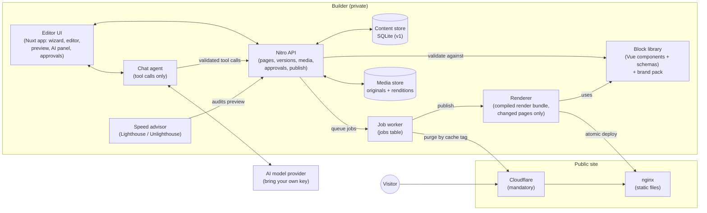

# Architecture

Draft, with the v1 shape decided. The general shape is borrowed from the research and from tools like Puck and Drupal Canvas. The detail lives in [13-data-model.md](13-data-model.md), [14-api.md](14-api.md), [15-security.md](15-security.md), [16-operations.md](16-operations.md) and the [decision records](decisions/).

## Overview

There are two separate sides:

1. **The builder** (private, behind a login): the editor UI, the chat agent, the Nitro API and the content store. Only staff use it.
2. **The public site**: plain static files on nginx, behind Cloudflare. Visitors only ever touch this.

The builder produces the public site. If the builder is down, the public site keeps running.



## Components

### Editor UI (Nuxt app)

The builder interface: setup wizard, page list, block editor, live preview with device widths, a contextual AI panel (only on certain screens) and approval screens. Vue 3 with Tailwind and Flowbite. See [04-gui.md](04-gui.md).

### Block library and brand pack

Each block is a Vue single-file component plus a schema for its props (types, required fields, length limits, image slot sizes). The brand pack is the locked output of the setup wizard: design tokens, fonts, logo, menus and the list of allowed templates and blocks. See [03-block-model.md](03-block-model.md) and [06-setup-wizard.md](06-setup-wizard.md).

The same block components render the editor preview and the published static page, so what you see is what ships.

Because pages hold content only, never styling, the look of the whole site comes from the active theme (design tokens plus block renderers). Switching theme and republishing changes the whole site. See [11-theming.md](11-theming.md).

### Chat agent

Talks to the AI model and can only act through a fixed set of tools (`list_blocks`, `add_block`, `update_props` and so on), scoped to one task and one target. Every tool call goes through the same services and validation as the GUI. The agent cannot publish. See [07-ai-agent.md](07-ai-agent.md).

### Nitro API

Nuxt's built-in server engine. Owns pages, versions, media, approvals and publishing. Validates every write with Zod against the block schemas and brand pack. Small and boring on purpose. The contract is in [14-api.md](14-api.md).

### Content store

SQLite only in v1, through Drizzle, written so Postgres can be added later ([ADR 0009](decisions/0009-sqlite-drizzle-and-jobs.md)). Every table has a `site_id`, with one site per install in v1 ([ADR 0007](decisions/0007-single-site-install.md)). Pages are JSON documents with versions; edits are operations in an edit log, which gives per-change undo and safe concurrent editing. See [13-data-model.md](13-data-model.md).

### Job worker

A `jobs` table and one worker loop inside the builder process: publishing, image renditions, checks, email, cache purge, backups and scheduled work. Retries, leases and a visible error. No queue service ([ADR 0009](decisions/0009-sqlite-drizzle-and-jobs.md), [16-operations.md](16-operations.md#background-jobs)).

### Media store

Original uploads plus renditions made at upload time (several widths, AVIF and WebP), on local disk in a shared, append-only folder outside the release folders ([ADR 0013](decisions/0013-renditions-at-upload.md)). See [05-image-pipeline.md](05-image-pipeline.md).

### Static generator

Blocks, theme and the site's own layer are **compiled once** into a render bundle (at install, upgrade, theme or token change). Each publish then **renders only the affected pages** to HTML with Vue's server renderer, into a new release folder (a hard-link copy of the last one), and switches a symlink. A dependency map decides which pages are affected. Each release has a manifest of exactly which versions it contains. See [ADR 0004](decisions/0004-incremental-publish.md) and [ADR 0005](decisions/0005-rollback-and-approval.md).

### nginx and Cloudflare

nginx serves the static files and only accepts requests from Cloudflare. Cloudflare sits in front for edge caching, TLS and protection, and is purged by cache tag after each publish. No Varnish. See [08-hosting.md](08-hosting.md).

### Speed advisor

Runs Lighthouse (headless Chromium, as a job) against the preview before approval and shows plain-English hints (heaviest image, render-blocking script, layout shift, missing alt text, page weight against a budget). The budgets are the same ones CI enforces ([17-testing-and-budgets.md](17-testing-and-budgets.md)). A scheduled Unlighthouse scan covers the whole live site.

## Main flows

### Create a page with the agent

1. Staff member opens New page, where the assistant appears, and asks for a page.
2. Agent asks a handful of questions, then builds a draft through tool calls.
3. Staff member previews it at desktop, tablet and mobile widths and iterates by chat or by editing blocks directly.
4. Staff member submits it for review.
5. Approver sees the preview, the diff and the speed advisor results, and approves or sends it back.
6. On approve: a publish job renders the affected pages, switches the release, and purges Cloudflare by tag. Page is live in seconds.

### Roll back

- **One page:** pick any earlier version, preview it, restore it as the draft, approve it. Same publish path as any other change.
- **Whole site (emergency):** an admin switches back to an earlier release. The database pointers are reset to that release's manifest in the same step. Logged, no second approver needed ([ADR 0005](decisions/0005-rollback-and-approval.md)).

## Suggested code layout

Start flat and only split when it hurts:

```
app/                  Builder UI
server/               Nitro API, database, services, job worker
shared/               Types, block schemas and rules shared by app and server
layers/blocks/        (later) block library as a Nuxt layer
layers/renderer/      (later) public site renderer as a Nuxt layer
site/                 The organisation's own blocks and themes (ADR 0006), not part of core
```

Nuxt layers let the block library and renderer be reused by the public site build without a separate package setup. If they need publishing to npm on their own later, they can move to `packages/`.

## Decided

- SQLite only in v1 ([ADR 0009](decisions/0009-sqlite-drizzle-and-jobs.md)).
- Publishing uses a compiled render bundle and renders changed pages only ([ADR 0004](decisions/0004-incremental-publish.md)).
- One site per install, `site_id` everywhere ([ADR 0007](decisions/0007-single-site-install.md)).
- The builder runs on the same server as nginx, as a separate container, behind Cloudflare Access ([ADR 0007](decisions/0007-single-site-install.md)).

## Open questions

- None at this level for v1. See [open-questions.md](open-questions.md).
