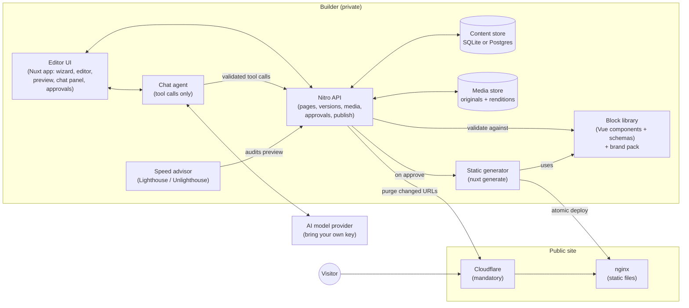

# Architecture

Draft. This is the general shape, borrowed from the research and from tools like Puck and Drupal Canvas. Details will change as the other docs fill in.

## Overview

There are two separate sides:

1. **The builder** (private, behind a login): the editor UI, the chat agent, the Nitro API and the content store. Only staff use it.
2. **The public site**: plain static files on nginx, behind Cloudflare. Visitors only ever touch this.

The builder produces the public site. If the builder is down, the public site keeps running.



## Components

### Editor UI (Nuxt app)

The builder interface: setup wizard, page list, block editor, live preview with device widths, chat panel and approval screens. Vue 3 with Tailwind and Flowbite. See [04-gui.md](04-gui.md).

### Block library and brand pack

Each block is a Vue single-file component plus a schema for its props (types, required fields, length limits, image slot sizes). The brand pack is the locked output of the setup wizard: design tokens, fonts, logo, menus and the list of allowed templates and blocks. See [03-block-model.md](03-block-model.md) and [06-setup-wizard.md](06-setup-wizard.md).

The same block components render the editor preview and the published static page, so what you see is what ships.

Because pages hold content only, never styling, the look of the whole site comes from the active theme (design tokens plus block renderers). Switching theme and republishing changes the whole site. See [11-theming.md](11-theming.md).

### Chat agent

Talks to the AI model and can only act through a fixed set of tools (`list_blocks`, `add_block`, `update_props` and so on). Every tool call goes through the API and is validated. The agent cannot publish. See [07-ai-agent.md](07-ai-agent.md).

### Nitro API

Nuxt's built-in server engine. Owns pages, versions, media, approvals and publishing. Validates every write against the block schemas and brand pack. Small and boring on purpose.

### Content store

SQLite by default (one file, easy backups, plenty for a typical organisation's site), Postgres as an option for larger installs. Pages are stored as JSON documents with append-only versions. Whether to support both from day one is an [open question](#open-questions).

### Media store

Original uploads plus generated renditions (several widths, AVIF and WebP), on local disk at first. See [05-image-pipeline.md](05-image-pipeline.md).

### Static generator

On approval, renders the changed pages to static HTML with `nuxt generate` (or a slimmer renderer built on the same components), then deploys atomically: build into a new folder, then switch a symlink. No half-published states.

### nginx and Cloudflare

nginx serves the static files. Cloudflare sits in front for edge caching, TLS and protection, and is purged for the changed URLs after each publish. No Varnish. See [08-hosting.md](08-hosting.md).

### Speed advisor

Runs Lighthouse against the preview before approval and shows plain-English hints (heaviest image, render-blocking script, layout shift, missing alt text, page weight against a budget). A scheduled Unlighthouse scan covers the whole live site.

## Main flows

### Create a page with the agent

1. Staff member opens the chat panel and asks for a page.
2. Agent asks a handful of questions, then builds a draft through tool calls.
3. Staff member previews it at desktop, tablet and mobile widths and iterates by chat or by editing blocks directly.
4. Staff member submits it for review.
5. Approver sees the preview, the diff and the speed advisor results, and approves or sends it back.
6. On approve: generate, deploy, purge Cloudflare. Page is live.

### Roll back

Pick any earlier version, preview it, approve it. Same publish path as any other change.

## Suggested code layout

Start flat and only split when it hurts:

```
app/                  Builder UI
server/               Nitro API
shared/               Types and schemas shared by app and server
layers/blocks/        (later) block library as a Nuxt layer
layers/renderer/      (later) public site renderer as a Nuxt layer
```

Nuxt layers let the block library and renderer be reused by the public site build without a separate package setup. If they need publishing to npm on their own later, they can move to `packages/`.

## Open questions

- SQLite only at first, or SQLite and Postgres from day one?
- Does the public site build reuse the whole Nuxt app, or a slimmer renderer app built from the same block layer?
- Single site per install at first, or multi-site from the start?
- Where does the builder itself run: same server as nginx, or separate?
