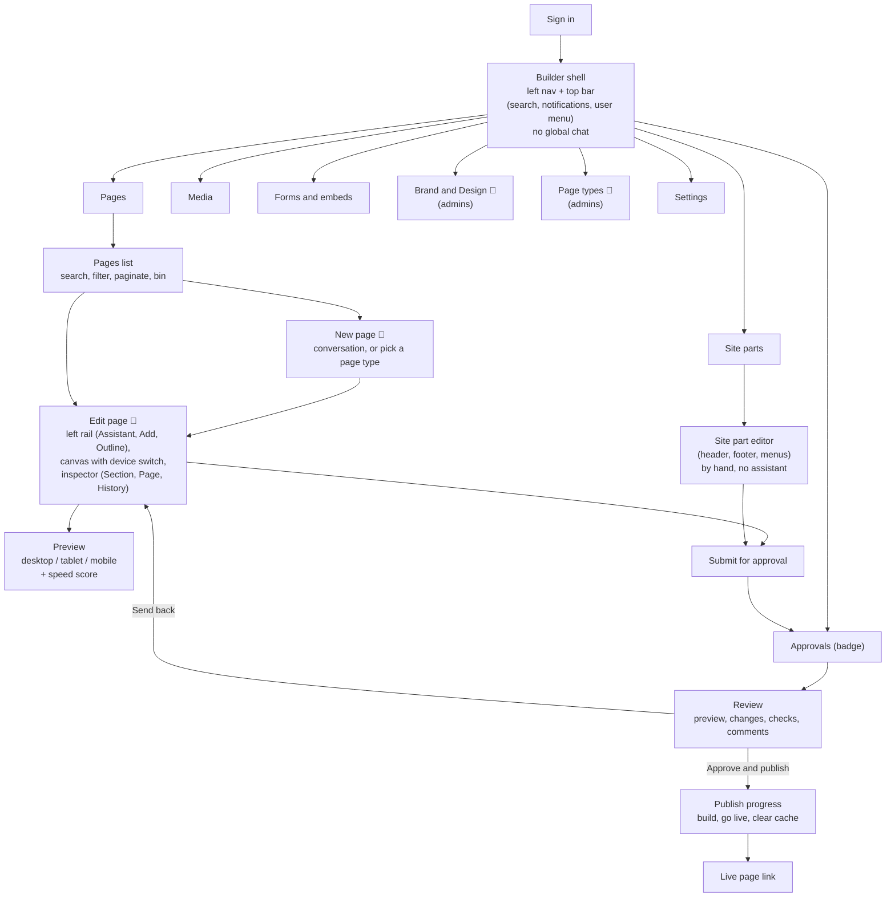

# Builder GUI

**Draft, with the v1 shape decided.** The editor layout, mobile scope and where the AI appears are locked in by [ADR 0008](decisions/0008-editor-shape.md) and [ADR 0012](decisions/0012-ai-panel-screens-v1.md). The journeys this GUI must serve are in [18-user-journeys.md](18-user-journeys.md).

Built with Vue 3, Tailwind and Flowbite / flowbite-vue.

## Look and feel

- **Calm and neutral.** The builder has its own quiet look (white and light grey, one accent colour for main actions). Only the canvas and previews use the site's theme.
- **Comfortable density.** 14 to 16 pixel text, generous spacing, large click targets. This is for busy charity staff, not web designers.
- **Plain words** from the [glossary](#glossary). No developer terms on screen.
- **One main action per screen**, always top right ("New page", "Submit for approval", "Approve and publish").
- **Status always visible** as a coloured label next to every page title, in lists and in the editor header.
- Items a user cannot use are **hidden, not greyed out**.

## Glossary

What staff see, and what it means in the docs and code.

| On screen | In the docs and code |
| --- | --- |
| Section | Block |
| Page type | Template |
| Draft | `draft` |
| Waiting for approval | `in_review` |
| Publishing | `approved` |
| Live | `published` |
| Live, with changes | `published` with a newer draft |
| Offline | `unpublished` |
| Submit for approval | Create a review |
| Send back | Review sent back with a comment |
| Approve and publish | Approve the pinned version and queue a publish |
| Site parts | Header, footer, menus, banner |
| Assistant | The AI panel and agent |
| History | Versions |
| Bin | Soft-deleted items |
| Look (Brand and Design) | Brand pack and themes |

## GUI map



🤖 marks the screens where the **assistant** appears ([ADR 0012](decisions/0012-ai-panel-screens-v1.md)): New page and Edit page for editors, approvers and admins; Page types and Brand and Design for admins. Nowhere else. Each screen starts its own task bound to the one thing being edited. See [12-ai-harness.md](12-ai-harness.md#task-scoped-tools).

### Left nav

| Item | What it holds | Who |
| --- | --- | --- |
| **Pages** | Pages list, page tree and addresses, new page, page editor, system pages such as 404, bin | Editors and up |
| **Site parts** | Header, footer, menus. Later: reusable sections, site banner | Approvers and up |
| **Media** | Library, upload, processing status, alt text, crops, bin | Editors and up |
| **Forms and embeds** | Registered donation forms (for example Virtuous) and other embeds by name. Only from domains on the admin allow-list | Approvers and up |
| **Approvals** | Items waiting for approval, with a count badge; the review screen | Approvers and up |
| **Brand and Design** 🤖 | Brand pack, contrast checks, favicon from logo, re-run wizard steps, Design tab for themes ([11-theming.md](11-theming.md)) | Admins |
| **Page types** 🤖 | Allowed page types, allowed and required sections per type | Admins |
| **Settings** | See below | Admins (System: operators) |

**Settings sections:**

| Section | Contents | Who |
| --- | --- | --- |
| General | Site name, primary domain, title pattern, favicon override | Admin |
| Workflow | Self-approval on or off ([ADR 0005](decisions/0005-rollback-and-approval.md)) | Admin |
| SEO and redirects | robots.txt, sitemap view, default social image, redirects table | Admin |
| Tracking and consent | Named integrations by id: GA4, Tag Manager, Plausible, Cookiebot ([ADR 0011](decisions/0011-named-tracking-integrations.md)) | Admin |
| Users and roles | Invite, deactivate, roles (Editor, Approver, Admin), operator flag | Admin |
| Integrations | AI provider, model and key; Cloudflare zone and token; email (Google Workspace) | Admin or operator |
| AI | Agent profile, site memory, usage and cost, caps | Admin |
| Security | Embed domain allow-list | Admin |
| Publishing and activity | Releases, site rollback, audit log (including AI tool calls) | Admin (log), approvers can view releases |
| Backups and export | Backup status, full export | Admin or operator |
| System | Version, disk, jobs, health, upgrades | Operator |

**Top bar:** site name, link to the live site, search (pages, media, sections; Ctrl or Cmd K), notifications bell, user menu (profile, password, notification settings, my assistant memory, sign out).

### Builder shell wireframe

```
+------------------+--------------------------------------------------------+
| sitebuilder      | Site name [View live] [Search  Ctrl K] (bell)  [User v]|
+------------------+--------------------------------------------------------+
| > Pages          |  Pages                          [Bin]   [+ New page]   |
|   Site parts     |  [Search...........]  Status [All v]  Type [All v]     |
|   Media          |  ------------------------------------------------------|
|   Forms/embeds   |  Title            Status        Last edited     Address|
|   Approvals (2)  |  Home             Live          2h ago, Asha    /      |
|   Brand/Design   |  Winter appeal    Draft         5m ago, Sam     -      |
|   Page types     |  About us         Waiting       1d ago, Priya   /about |
|   Settings       |  Volunteer        Live, changes 3d ago, Asha    /volun.|
|                  |                                  < 1 2 3 ... 9 >       |
+------------------+--------------------------------------------------------+
```

## Page editor

### Layout

```
+---------------------------------------------------------------------------------+
| < Pages  Winter appeal [Draft]  Saved      [Desktop|Tablet|Mobile]  Undo Redo    |
|                                             Preview   [Submit for approval]     |
+--+-------------------+---------------------------------------+-----------------+
|  | Assistant|Add|Outline                                     | Section|Page|History|
|  |                   |                                       |                 |
|  | (one tab open)    |     Canvas at the chosen width        | Fields for the  |
|  |                   |     real sections, site theme         | selected section|
|  | Assistant: chat,  |     click text to type in place       |                 |
|  | progress, cards   |     click a section to select it      | Heading [_____] |
|  | Add: section list |                                       | Photo  [Change] |
|  | Outline: drag to  |                                       |        [Crop]   |
|  | reorder           |                                       | Button [_____]  |
|  | [message box]     |                                       |                 |
+--+-------------------+---------------------------------------+-----------------+
 ^ nav collapsed to icons
```

- **Left rail, tabbed:** Assistant (only where allowed), Add (sections allowed for this page type), Outline (drag, or Alt with up and down arrows, to reorder). One tab open at a time. The rail collapses to icons.
- **Canvas:** the page rendered with the real sections and the site's theme, at the width chosen in the toolbar (Desktop 1280, Tablet 768, Mobile 390). Narrower than the space available, it is centred on grey; wider, it scales down to fit and says so ("Shown at 80%").
- **Inline text:** headings and body text are edited on the canvas. A character counter appears as you near a section's limit. Pasted text is cleaned into the rich text format ([ADR 0010](decisions/0010-zod-versioned-blocks-structured-rich-text.md)).
- **Inspector, tabbed:** **Section** (the selected section's fields, generated from its schema), **Page** (title, address, parent, page type, SEO: title, description, social image, canonical, hide from search engines), **History** (versions). It slides away when nothing is selected, giving the canvas the room.
- **Section toolbar** on the canvas when a section is selected: move up, move down, duplicate, remove, and "Ask the assistant about this section" (pre-fills the chat).
- **Flat sections in v1.** No nesting. Layout choices are options on a section.

### Save, undo and history

- **Autosave.** Every change is sent as an operation within a second ([13-data-model.md](13-data-model.md#versions-drafts-and-autosave)). The header shows **Saving...**, then **Saved**. There is no Save button.
- **Offline.** If the connection drops, changes are kept in the browser and a banner says "You're offline. Your changes will save when you're back." Nothing is lost on a reload.
- **Undo and redo** (toolbar, Ctrl or Cmd Z, Shift Z) work across your own changes in this session, including assistant changes you asked for. Each assistant change line also has its own **Undo**.
- If someone else changed the same thing since, undo explains instead of guessing: "Sam has changed this heading since, so it can't be undone automatically."
- **Two people on one page:** the other person's avatar shows in the header ("Sam is editing"). If you both change the same field, you see "Sam changed this a moment ago" with **Keep mine** and **Use Sam's**.
- **History tab:** a timeline of saved versions (who, when, a summary, "Live" marker). Assistant turns, submissions and publishes are separate entries. **Save a version** with a name is available for "before I try something".

### Assistant states

| State | What the panel shows | Canvas |
| --- | --- | --- |
| Ready | Greeting for the task, 3 suggested prompts | Normal |
| Thinking | "Thinking..." with a soft animation, Stop button | Normal |
| Working | Checklist of steps as they happen, Stop button | Sections being changed glow; you can still scroll and look |
| Checking | "Checking it on a phone and a computer..." | Normal |
| Needs you | An inline card: crop this photo, upload a photo, pick one of these forms | The relevant section is highlighted |
| Done | Short summary of changes, each with Undo; next suggested step | Normal |
| Stopped | "Stopped. Here's what I'd done so far." Changes kept, each with Undo | Normal |
| Limit reached | "That's as far as I can go in one go. Here's what's left." | Normal |
| Monthly budget used | "This month's assistant budget is used up. You can still edit by hand." | Normal |
| Unavailable | "The assistant isn't available right now. Everything else works as normal." Retry | Normal |
| Off-remit | A polite decline and a redirect to what it can do | Normal |

While the assistant is working, typing in the canvas is allowed. If you change something it is about to change, its next step sees your change (it always reads the latest draft).

## Preview

- **Preview** opens the page exactly as it will be published, outside the editor chrome, rendered with the same render bundle as publishing ([ADR 0004](decisions/0004-incremental-publish.md)).
- Toolbar: back to editing, Desktop, Tablet, Mobile (1280, 768, 390), a custom width box, and the speed score with the top hints.
- Renders in an iframe sized to the width, so media queries behave as on a real device.
- **Share preview** (approvers and up): a link that works without signing in, expires after 7 days, can be revoked, and is never indexed. For trustees and partners.

```
+---------------------------------------------------------------------------+
| [< Back to editing]  [Desktop] [Tablet] [Mobile] [ 1024 ]  Speed: 98  [Share] |
+---------------------------------------------------------------------------+
|                                                                           |
|                        page at the chosen width                           |
|                                                                           |
+---------------------------------------------------------------------------+
```

## Approval flow

1. **Submit for approval** opens a panel: optional note, an automatic change summary (editable), and the checks ([17-testing-and-budgets.md](17-testing-and-budgets.md#checks-before-review)). Blocking problems have **Fix** links.
2. The review is **pinned to that version**. Editing the draft afterwards withdraws it, with a warning before the first edit.
3. The approver opens it from the email or **Approvals**.
4. **Approve and publish** or **Send back** (comment required).
5. Publish progress, then a link to the live page.

Page states and transitions are defined once in [13-data-model.md](13-data-model.md#page-workflow-states).

### Review screen

```
+---------------------------------------------------------------------------------+
| Review: Winter appeal  by Asha, 10 min ago          [Send back] [Approve & publish]|
+---------------------------------------------------------------------------------+
| [Desktop] [Tablet] [Mobile]     ( ) Preview  (o) Show changes                    |
+-----------------------------------------------------+---------------------------+
|                                                     | Asha's note               |
|   page at chosen width                              |  "New appeal for Dec"     |
|   changed sections outlined,                        | Changes                   |
|   changed words highlighted,                        |  + Hero added             |
|   "Removed: Quote" strip where a section went       |  ~ Heading changed        |
|                                                     |  - Quote removed          |
|   [comment pin on a section]                        | Checks                    |
|                                                     |  ok Alt text              |
|                                                     |  ! Hero photo 410 KB      |
|                                                     |  Speed 97                 |
|                                                     | Comments                  |
|                                                     |  [Add a comment...]       |
+-----------------------------------------------------+---------------------------+
```

- **Show changes** is the default for edits to a live page; **Preview** is the default for new pages.
- Clicking a change in the list scrolls to it.
- Comments can be pinned to a section and are shown to the submitter in the editor next to that section.
- Blocking checks disable **Approve and publish**, with an **Override** link that asks for a reason (logged).
- If the draft changed after submission, the screen says so and approval is disabled.
- Works on a phone: the right column becomes tabs under the preview.

### Publish progress

```
+--------------------------------------------------------------+
|  Publishing Winter appeal                                     |
|  [x] Building        [x] Going live       [ ] Clearing cache  |
|  ...........................................                  |
+--------------------------------------------------------------+
```

Ends with "Live" and **View page**. Menu, header or footer changes say "Updating every page (about a minute)".

## Other screens

### New page

```
+---------------------------------------------------------------+
| < Pages   New page                                             |
+---------------------------------------------------------------+
|                                                               |
|      Assistant: Hi Asha. What's this page for?                |
|                                                               |
|      [A donation appeal] [A news story] [An event] [Other]    |
|                                                               |
|      [ Type a message...                         ] [Send]     |
|                                                               |
|      Or pick a page type yourself                             |
+---------------------------------------------------------------+
```

After **Build it**, it becomes the editor layout with the Assistant tab open.

### Site parts: menus

```
+---------------------------------------------------------------------------+
| Site parts > Main menu [Live]               [Preview]  [Submit for approval]|
+-------------------------------------+-------------------------------------+
| = Home                         [..] |  Header preview  [Computer][Phone]  |
| = About us                     [..] |                                     |
|     = Our team                 [..] |  [logo] Home  About v  Adopt  Donate|
| = Adopt                        [..] |                                     |
| = Volunteer (draft!)           [..] |                                     |
| [+ Add item]                        |                                     |
+-------------------------------------+-------------------------------------+
```

Header and footer use the page editor layout without the assistant tab, limited to the sections allowed in them.

### Media library and item

```
+---------------------------------------------------------------------------+
| Media                                [Search...]  [Type v]  [+ Upload]     |
+---------------------------------------------------------------------------+
| [img] [img] [img] [img] [img] [img]                                        |
| [img] [img] [img]  Drag photos here to upload                              |
+---------------------------------------------------------------------------+

Item panel (right):  preview | Alt text [______] [Suggest] [ ] Decorative
                     Focal point: click the photo | Crops: 16:9 approved
                     Used on: Home, Winter appeal | Size 3200 x 2133 | [Bin]
```

### Crop dialog

```
+-------------------------------------------------------------+
| Crop for: Hero (needs 16:9, at least 1280 x 720)             |
+-------------------------------------------+-----------------+
|                                           | On a computer    |
|     photo with a 16:9 frame you can       | [small preview]  |
|     move and resize (shape is locked)     | On a phone       |
|                                           | [small preview]  |
+-------------------------------------------+-----------------+
|                                  [Cancel]  [Use this crop]  |
+-------------------------------------------------------------+
```

### History

```
History                                  [Save a version]
o  Now          Draft (autosaved)        Asha
o  10:42        Assistant: changed hero  Asha + Assistant
*  Yesterday    LIVE  Approved by Spencer
o  3 Nov        Submitted                Asha
   [View]  [Restore this version]
```

### Setup wizard

```
Step 2 of 5: Site parts                       [Save and finish later]
(1 Brand) (2 Site parts) (3 Page types) (4 Integrations) (5 Preview)
+-------------------------------------+--------------------------------+
| Header style: (o) Simple ( ) Centre | Live preview of header and     |
| Main menu: [list editor]            | footer with your brand         |
| Footer: contact, social, legal      |                                |
+-------------------------------------+--------------------------------+
                                        [Back]  [Next: Page types]
```

### Mobile mode

```
+------------------------+
| Winter appeal  [Live]  |
| [Search pages...]      |
+------------------------+
| page, full width       |
| tap text to edit  ->   |
|  full-screen text      |
|  editor with [Done]    |
+------------------------+
| [Submit for approval]  |
+------------------------+
```

On phones the builder offers: Pages (search and open), text edits, swapping a photo for one already uploaded, Approvals (review and approve), notifications. Everything else says "Open on a computer to do this."

## Patterns

### Errors and validation

- **Where:** on the field, and on the section in the canvas (a small red marker), never only as a toast.
- **How:** say what happened and what to do, in plain words, with no codes. "This heading is too long. Keep it under 80 characters (it's 94)."
- **Server errors:** "Something went wrong saving that. We've kept your change and will try again." with a reference id for support.
- **Blocking checks** are listed in the submit panel with **Fix** links.

### Empty states

| Screen | Empty state |
| --- | --- |
| Pages (new site) | "No pages yet." [Make one with the assistant] [Pick a page type] |
| Media | "No photos yet. Drag some here." |
| Approvals | "Nothing waiting. Nice work." |
| History | "This is the first version." |
| Search | "Nothing found for 'wintr'. Try fewer words." |
| Bin | "The bin is empty. Deleted items stay here for 30 days." |

### Loading

- Skeletons for lists and the canvas, not spinners.
- Anything over 2 seconds shows what it is doing ("Making web-friendly sizes...").

### Notifications

In-app (bell) and email ([16-operations.md](16-operations.md#email)): review requested, sent back (with comment), published, publish failed, emergency rollback. Each links straight to the thing.

### Keyboard shortcuts

| Keys | Does |
| --- | --- |
| Ctrl or Cmd K | Search and jump |
| Ctrl or Cmd Z, Shift Z | Undo, redo |
| Ctrl or Cmd Enter | Send to the assistant |
| / | Focus the assistant box |
| Esc | Deselect, close panels |
| Alt Up, Alt Down | Move the selected section |
| Ctrl or Cmd Shift P | Preview |
| ? | Show all shortcuts |

### Accessibility of the builder

The builder itself meets **WCAG 2.2 AA**: everything works by keyboard, focus is always visible, controls are labelled, and reordering never needs dragging.

## Roles

- **Editor:** create and edit drafts, use the assistant, upload media, submit for approval.
- **Approver:** everything an editor can do, plus approve and publish, unpublish, Site parts, Forms and embeds, redirects.
- **Admin:** everything, plus Brand and Design, Page types, users, settings, integrations and emergency site rollback.
- **Operator** (a flag, can be combined with any role or none): System, backups, upgrades and integrations, without content rights ([ADR 0007](decisions/0007-single-site-install.md)).

## Open questions

- Editor base: build our own, decided in [ADR 0014](decisions/0014-first-party-vue-editor.md).
- Exact section toolbar actions beyond move, duplicate and remove.
- Builder UI translation (for example Hindi for staff in India): wanted, and when?
