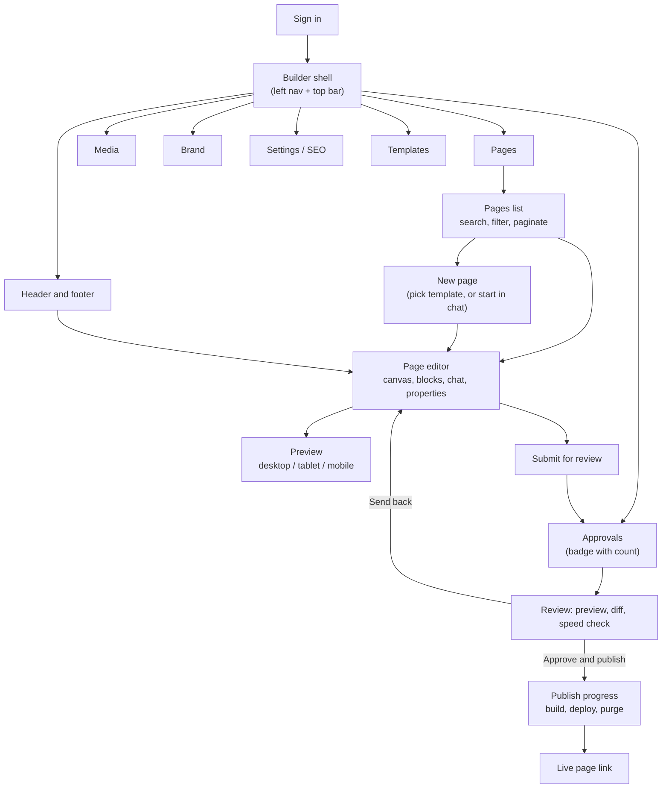
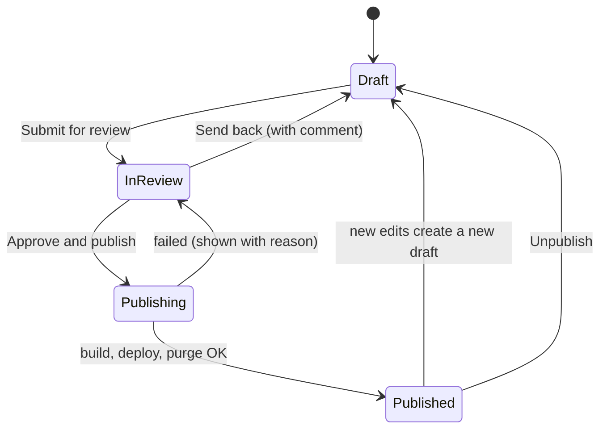

# Builder GUI

**Draft for discussion.** We still need to think properly about how the GUI should work. This doc collects the current ideas and the open questions. Nothing here is final.

Built with Vue 3, Tailwind and Flowbite / flowbite-vue.

## GUI map (early sketch)

An early sketch to help think it through, not a spec. The nav items and screens below are examples (several come from the [candidate essentials](10-essentials.md)) and may change completely.



### Left nav (example)

| Item | What it holds | Who |
| --- | --- | --- |
| **Pages** | Pages list (paginated, search and filter, status, last edited), new page, page editor | Editors and up |
| **Header and footer** | The site-wide header (logo, menu, CTA) and footer blocks, edited like a page | Approvers and up |
| **Media** | Image and video library, upload, crop, alt text | Editors and up |
| **Brand** | Brand pack: colours, fonts, logo, shapes. Re-run wizard steps | Admins |
| **Settings / SEO** | Site name, title pattern, default social image, robots.txt, redirects, sitemap, analytics and consent slots, integrations (AI key, Cloudflare, donation forms), users and roles | Admins |
| **Templates** | Allowed templates, allowed and required blocks per template | Admins |
| **Approvals** | Drafts waiting for review, with a count badge | Approvers and up |

The top bar holds the site name, a link to the live site, the chat toggle and the user menu. Items a user cannot use are hidden, not greyed out.

### Builder shell wireframe

```
+------------------+--------------------------------------------------------+
| sitebuilder      |  Site name  [View live site]          [Chat] [User v]  |
+------------------+--------------------------------------------------------+
| > Pages          |  Pages                                     [+ New page] |
|   Header/footer  |  [Search...........]  Status [All v]  Template [All v]  |
|   Media          |  ------------------------------------------------------ |
|   Brand          |  Title            Status      Last edited      URL      |
|   Settings / SEO |  Home             Published   2h ago, Asha    /        |
|   Templates      |  Winter appeal    Draft       5m ago, Sam      -        |
|   Approvals (2)  |  About us         In review   1d ago, Priya    /about   |
|                  |  ...                                                    |
|                  |                                  < 1 2 3 ... 9 >        |
+------------------+--------------------------------------------------------+
```

## Page editor layout (sketch)

```
+---------------------------------------------------------------------------+
| < Pages   Winter appeal (draft)          [Preview] [Submit for review]    |
+------------------+----------------------------------------+---------------+
| Blocks           |                                        | Chat          |
|  + Hero          |          Live page canvas              |               |
|  + Rich text     |   (real block components, on-brand)    | Agent: What's |
|  + Stats         |                                        | the headline? |
|  + Donation form |   click a block to select it           |               |
|  ...             |                                        | You: ...      |
|                  |                                        |               |
| Outline          |                                        |               |
|  1. Hero         +----------------------------------------+               |
|  2. Rich text    | Selected block: Hero                   | [message box] |
|  3. Donation     |  Heading [______]  Image [Change/Crop] |               |
+------------------+----------------------------------------+---------------+
```

Four parts:

- **Block panel** (left): block palette (only the blocks allowed for this template) and an outline for reordering.
- **Canvas** (middle): the page rendered with the real block components, at a chosen width. Click a block to select it.
- **Chat panel** (right, collapsible): the agent. Its changes appear on the canvas as they happen.
- **Properties panel**: the selected block's fields, generated from the block schema (text, image with crop, link, options). Shown under the canvas or as a drawer; see open questions. A **Page** tab in the same panel holds page settings and SEO (title, description, social image, canonical, noindex).

When the left nav is open the editor is cramped, so the editor collapses the nav to icons.

## Preview

- A **Preview** button opens the page as it will look when published, outside the editor chrome.
- The preview has a **toolbar at the top** to switch between **Desktop**, **Tablet** and **Mobile** widths (for example 1280, 768 and 390 pixels), plus a button to go back to editing.
- The preview renders inside an iframe sized to the chosen width, so media queries behave exactly as on a real device.
- Later: show the speed advisor results in the preview toolbar (score and top hints).

```
+---------------------------------------------------------------+
| [< Back to editor]   [Desktop] [Tablet] [Mobile]   Speed: 98  |
+---------------------------------------------------------------+
|                                                               |
|                   page at the chosen width                    |
|                                                               |
+---------------------------------------------------------------+
```

## Chat panel

- Always available in the editor, collapsible.
- The agent asks a handful of questions for a new page, then builds a draft. See [07-ai-agent.md](07-ai-agent.md).
- Each agent change is shown as a short line in the chat ("Added Hero", "Changed heading") and can be undone individually.
- The person can mix chat and direct editing freely.

## Approval flow

1. Editor clicks **Submit for review**.
2. Approver opens it from **Approvals** and sees: the preview (with the device toolbar), a diff against the live version, and the speed advisor results.
3. Approver clicks **Approve and publish**, or **Send back** with a comment.
4. On publish, a progress indicator shows build, deploy and cache purge, then a link to the live page.



```
+---------------------------------------------------------------------------+
| Review: Winter appeal                       [Send back]  [Approve & publish]|
+---------------------------------------------------------------------------+
| [Desktop] [Tablet] [Mobile]     View: (o) Preview  ( ) Diff vs live        |
+-------------------------------------------------+-------------------------+
|                                                 | Speed check: 97         |
|           page preview at chosen width          |  ! Hero image 410 KB    |
|           (changed blocks outlined in diff)     |  ok Alt text present    |
|                                                 | Changes                 |
|                                                 |  + Hero added           |
|                                                 |  ~ Heading changed      |
|                                                 | SEO: title, desc ok     |
+-------------------------------------------------+-------------------------+
```

## Image crops in the editor

When an image does not fit a block's required size, the editor shows a crop rectangle locked to the right aspect ratio and the user must approve the crop. See [05-image-pipeline.md](05-image-pipeline.md).

## Roles (first idea)

- **Editor:** create and edit drafts, use the agent, submit for review.
- **Approver:** everything an editor can do, plus approve and publish.
- **Admin:** everything, plus brand pack, menus, templates, users and integrations.

## Open questions

- Is the main way in the chat, or the visual editor? Should a new page start in chat by default?
- Where does the chat panel live: fixed right column, floating panel, or a full-screen "conversation" mode that hands over to the editor?
- Drag and drop on the canvas, or reorder only in the outline? (Drag and drop is nice but adds complexity.)
- Inline text editing on the canvas, or fields in a side panel only?
- How is the diff shown: side by side, or highlighted changes on one page?
- Should small teams be allowed to approve their own changes (one-person organisations)?
- Exact device widths for the preview toolbar, and whether to offer a custom width.
- Do we build our own Vue editor from scratch, or start from an existing one (for example Gissen or Page Composer)?
- Mobile use of the builder itself: needed, or desktop only?
- Properties panel: under the canvas, a right-hand drawer that shares space with chat, or a popover next to the selected block?
- Should Header and footer be editable by approvers, or admins only?
- Does Templates belong in the main nav, or inside Settings (it is rarely used after setup)?
