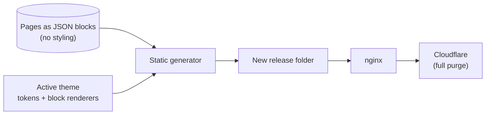

# Theming

**Draft.** How the look of a whole site can change without touching its content.

## The idea

Pages are stored as structured JSON blocks: content and choices (`tone: "primary"`, `layout: "split"`), never colours, fonts, spacing or markup. See [03-block-model.md](03-block-model.md).

So the look of the site lives entirely in the **theme**:

- **Design tokens:** colours, fonts, type scale, spacing, radius, shadows, motion (the brand pack from the [setup wizard](06-setup-wizard.md) feeds these).
- **Block renderers:** the Vue component for each block type, which decides the markup and layout.

Change the active theme, rebuild the static output, purge Cloudflare, and the whole site has a new look with the same content, URLs and SEO.

## Two levels

1. **Token-only themes:** same block renderers, different tokens. Cheap to make, safe, and the brand wizard can produce them. Good for colour and type changes.
2. **Full themes:** their own block renderers as well as tokens, for a genuinely different design. More work, and code, so they go through developer review.

A theme is a Nuxt layer that provides tokens and can override block renderers. Core themes ship with core; an organisation's own themes live in its `site/themes/` folder ([ADR 0006](decisions/0006-site-layer.md)). Switching theme recompiles the render bundle and re-renders the whole site ([ADR 0004](decisions/0004-incremental-publish.md)).

## Uses

- **Demos:** show two or three versions of the same site, from the same content, to let people pick a favourite (the first pilot plan in [09-roadmap.md](09-roadmap.md)).
- **Redesigns:** build and preview a new theme against the live content, then switch in one publish, with rollback to the previous release.
- **Seasonal or campaign looks:** later, perhaps.

## Previewing a theme

- Preview any page (or the whole site, on a preview hostname) with a non-active theme, using the normal desktop, tablet and mobile toolbar.
- Switching the live theme is an admin action that goes through approval like any other publish, triggers a full rebuild and a full Cloudflare purge.

## Caveats

- **Every theme must cover every block** in the library, or declare a fallback (usually the default theme's renderer, styled with its own tokens). The build should fail, or warn loudly, if a block has no renderer.
- **Block props are shared across themes.** A theme cannot require props other themes do not have. If a theme needs a new option, it becomes part of the block schema with a sensible default.
- **Image slot sizes may differ between themes** (a tall hero in one, a wide one in another). Required crops then need re-approving for the new theme. The crop data model keys crops by slot size so both can coexist.
- **Speed and accessibility** checks apply to every theme, not just the default one.
- **Full rebuild** on switch, so larger sites take longer to publish.

## Decided

- A theme is a Nuxt layer: in core, or in the site's own `site/themes/` ([ADR 0006](decisions/0006-site-layer.md)).
- The builder UI always uses its own neutral look; only the canvas and previews use the site theme ([ADR 0008](decisions/0008-editor-shape.md)).
- One theme per site in v1.
- Header and footer can be light or dark. A dark one uses the optional dark-background logo from the brand pack, or a CSS filter fallback (`theme-default-4`).

## Open questions

- How are third-party themes reviewed if the project becomes open source?
