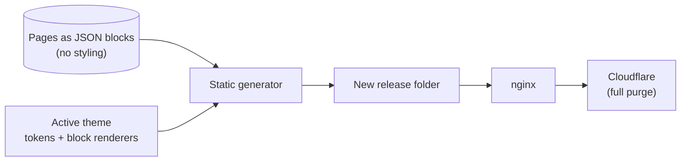

# Theming

**Draft.** How the look of a whole site can change without touching its content.

## The idea

Pages are stored as structured JSON blocks: content and choices (`tone: "primary"`, `layout: "split"`), never colours, fonts, spacing or markup. See [03-block-model.md](03-block-model.md).

So the look of the site lives entirely in the **theme**:

- **Design tokens:** colours, fonts, type scale, spacing, radius, shadows, motion (the brand pack from the [setup wizard](06-setup-wizard.md) feeds these).
- **Block renderers:** the Vue component for each block type, which decides the markup and layout.

Change the active theme, rebuild the static output, purge Cloudflare, and the whole site has a new look with the same content, URLs and SEO.

## Two levels

1. **Token-only themes:** same block renderers, different tokens. Cheap to make, safe, and the brand wizard can produce them. Good for colour and type changes.
2. **Full themes:** their own block renderers as well as tokens, for a genuinely different design. More work, and code, so they go through developer review.

A theme is a Nuxt layer that provides tokens and can override block renderers. Core themes ship with core; an organisation's own themes live in its `site/themes/` folder ([ADR 0006](decisions/0006-site-layer.md)). Switching theme recompiles the render bundle and re-renders the whole site ([ADR 0004](decisions/0004-incremental-publish.md)).

## Uses

- **Demos:** show two or three versions of the same site, from the same content, to let people pick a favourite (the first pilot plan in [09-roadmap.md](09-roadmap.md)).
- **Redesigns:** build and preview a new theme against the live content, then switch in one publish, with rollback to the previous release.
- **Seasonal or campaign looks:** later, perhaps.

## Previewing a theme

- Preview any page (or the whole site, on a preview hostname) with a non-active theme, using the normal desktop, tablet and mobile toolbar.
- Switching the live theme is an admin action that goes through approval like any other publish, triggers a full rebuild and a full Cloudflare purge.

## Caveats

- **Every theme must cover every block** in the library, or declare a fallback (usually the default theme's renderer, styled with its own tokens). The build should fail, or warn loudly, if a block has no renderer.
- **Block props are shared across themes.** A theme cannot require props other themes do not have. If a theme needs a new option, it becomes part of the block schema with a sensible default.
- **Image slot sizes may differ between themes** (a tall hero in one, a wide one in another). Required crops then need re-approving for the new theme. The crop data model keys crops by slot size so both can coexist.
- **Speed and accessibility** checks apply to every theme, not just the default one.
- **Full rebuild** on switch, so larger sites take longer to publish.

## Decided

- A theme is a Nuxt layer: in core, or in the site's own `site/themes/` ([ADR 0006](decisions/0006-site-layer.md)).
- The builder UI always uses its own neutral look; only the canvas and previews use the site theme ([ADR 0008](decisions/0008-editor-shape.md)).
- One theme per site in v1.
- Header and footer can be light or dark. A dark one uses the optional dark-background logo from the brand pack, or a CSS filter fallback. The published default bundle id is `theme-default-5`.

## Public default theme

The public look is one style sheet in `shared/theme-css.ts`. Brand colours are the ten inputs below. `themeCssFromTokens` replaces the whole `:root` block, so derived values follow the brand. Rules use `var()` and `color-mix`. Filled buttons (`.btn`, `.cta-btn`) use `--accent` with `--accent-ink` text, and the hover fill is `--accent-strong`. `--decor` and `--highlight` are decoration: the quote rule, the selected-tier shadow, focus rings, the footer gold line, and the warm donate and call-to-action bands. They are not fills behind light text. `--accent-ink` is the text colour on `--accent`, `--urgent` and `--celebrate`. The Donate button does not pulse, and the theme sheets contain no `@keyframes`.

### Brand inputs

| Token | Property | Default | Where it is used |
| --- | --- | --- | --- |
| `ink` | `--ink` | `#1f1b16` | Body text, dark header and footer, hero scrim, dark footer gradient |
| `paper` | `--paper` | `#fffaf3` | Page background, light text on dark surfaces, the solid over-hero bar |
| `muted` | `--muted` | `#5c564e` | Navigation, ledes, secondary labels, the simple footer |
| `accent` | `--accent` | `#b5471d` | Links and filled buttons, the accent banner, progress, focus outlines |
| `accentInk` | `--accent-ink` | `#fffaf3` | Text on filled accent, urgent and celebrate banners |
| `line` | `--line` | `#e6dccf` | Borders and the header rule |
| `band` | `--band` | `#f3ebe1` | Info banner, embed band, neutral match banner |
| `urgent` | `--urgent` | `#8b1e1e` | Urgent banner fill |
| `celebrate` | `--celebrate` | `#2e5a3c` | Celebrate banner fill |
| `highlight` | `--highlight` | `#f3b53f` | Footer rule and tag, focus rings, donate-box border, warm bands |

### Derived properties

| Property | Value | Where it is used |
| --- | --- | --- |
| `--surface` | `color-mix` of `--paper` 25% with white | Site-title pill, cards, secondary buttons, footer logo chip |
| `--accent-strong` | `--accent` mixed 82% toward black | Filled-button hover, eyebrows, accent gradients |
| `--decor` | `--accent` mixed 45% with `--highlight` | Quote border and the selected-tier shadow |
| `--radius-pill` | `999px` | Buttons, site title, progress, carousel controls |
| `--radius-card` | `20px` | Cards, donate box, embed box |
| `--radius-tile` | `14px` | Tiers, stat tiles, FAQ items |
| `--radius-media` | `12px` | Photos in split, figure, gallery and before-and-after |
| `--shadow-card` | ink at 10% | Cards and the site-title pill |
| `--shadow-raised` | ink at 12% | Buttons sitting on an accent band |
| `--shadow-selected` | decor at 18% | Tier hover and focus |
| `--fs-body`, `--lh-body` | `17px`, `1.6` | Body copy and prose |
| `--fs-display` | `clamp(28px, 6.2vw, 52px)` | Hero heading |
| `--fs-h2` | `clamp(26px, 7vw, 42px)` | Section headings and quotes |
| `--fs-h3` | `clamp(20px, 4.5vw, 28px)` | Prose headings, between body and the section heading |
| `--fs-big` | `clamp(44px, 13vw, 72px)` | Match thermometer total |
| `--fs-stat` | `clamp(19px, 5.6vw, 26px)` | Stat values |
| `--fs-eyebrow` | `13px` | Eyebrows |
| `--section-y` | `clamp(48px, 6vw, 72px)` | Section, call-to-action and donate padding |

`--max` (`70rem`) and `--space` (`1.25rem`) set the column width and the page inset.

### Heroes

Hero `mode` is one of four values: `image` (one photo), `video` (one clip), `image-carousel` or `video-carousel`. VideoHero stays a single muted looping clip with a poster. Several clips belong on Hero.

Carousel rules live in `HERO_CAROUSEL_CSS`. They are appended only when a Hero is in a carousel mode and has at least two slides. The same check emits `<script src="/hero.js" defer>`, and the release writes `/hero.js` only when a published page references it. Without that script the first slide stays visible and the controls stay hidden. The script attaches a video source only on the active slide, and only when the viewport is at least 641px wide and the reader has not asked for reduced motion. CSS hides `.hero-video` in both of those cases as well.

## Custom CSS

Site-wide CSS is not a theme. It is stored on the brand as `customCss` and is published and rolled back with the brand. On each page the style sheet is, in order: the theme CSS (or the brand's token rewrite of it), the optional shell sheets, a non-white logo-pill override when one is set, carousel CSS when that page has a carousel, match-thermometer CSS when that page has a MatchThermometer, gift-picker CSS when an ImpactTiers block uses `layout: picker`, donation-preview CSS when the page has a DonationEmbed, section-rhythm CSS when a block sets `background` to `card` or `warm`, the site CSS, then each section's CSS. Section CSS is stored beside `props` as `css` and is prefixed to that section when the page is rendered. See [ADR 0019](decisions/0019-custom-css.md).

The published style block is capped at 80951 bytes, counted as UTF-8. Site CSS may use 32768 of that and one section may use 8192. The shell (theme plus every optional shell sheet) is capped at **29751 bytes** on its own. The original shell cap was 24576, which is the old 65536 minus site and section. It is not `80951 - 32768 - 8192`. Menu A deleted the boxed hamburger, the narrow mega panel and a duplicate see-through weight rule. The shell still measured 29751 bytes, 5175 over 24576, so the cap and `STYLE_MAX_BYTES` each rose by that overrun. Before Menu A the shell was 24260 of 24576, with 316 bytes of headroom. The extra 10240 bytes are `BLOCK_CSS_MAX_BYTES`, an allowance for inline block sheets. Those sheets are appended only on pages that use the feature, and they must not be folded back into the shell cap. Shell sheets are `THEME_CSS`, `HEART_CSS`, `UTILITY_CSS`, `BANNER_ACCENT_CSS`, `FOOTER_COLUMNS_CSS`, `OVER_HERO_CSS`, `TILE_CSS` and `HERO_CAROUSEL_CSS`. The budget test adds all of them. Measured on the current public theme: `THEME_CSS` 19791, `HEART_CSS` 191, `UTILITY_CSS` 333, `BANNER_ACCENT_CSS` 224, `FOOTER_COLUMNS_CSS` 2203, `OVER_HERO_CSS` 2935, `TILE_CSS` 1516, `HERO_CAROUSEL_CSS` 2552. The eight shell sheets together are 29745 bytes, 6 under the 29751 cap. Section rhythm (`.bg-card` and `.bg-warm`) and the donation-form preview could not fit in that spare, so they are optional block sheets: `RHYTHM_CSS` is 158 bytes and is emitted only when a block sets `background` to `card` or `warm`; `DONATE_PREVIEW_CSS` is 937 bytes and is emitted only when the page has a DonationEmbed. `THERMOMETER_CSS` is 4595 bytes and `PICKER_CSS` is 4512. The four block sheets together are 10202 of the 10240 block allowance, with 38 bytes to spare. A worst-case page (every shell sheet, all four block sheets, a full site stylesheet and a full section stylesheet) is 80907 bytes, inside the 80951 cap with 44 bytes to spare. The caps were not raised for this.

The editor canvas prefixes that same sheet with `.sb-canvas` (`app/utils/theme-css.ts`). The scoper reads one line at a time. A rule keeps its `{` on the selector line. A line that starts with `@` is copied through, so the theme sheets contain no `@keyframes` (a keyframe would paint outside the canvas). Selector commas are split on that line, so a selector must not hide a comma inside `:is()`. Commas inside `color-mix()` stay in the declaration, after `{`. Carousel, thermometer, gift-picker, donation-preview and section-rhythm rules on the canvas use the same scoper, and only when the page has that feature.

## Open questions

- How are third-party themes reviewed if the project becomes open source?
