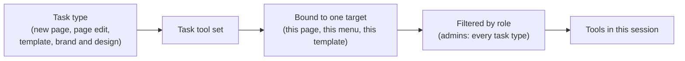
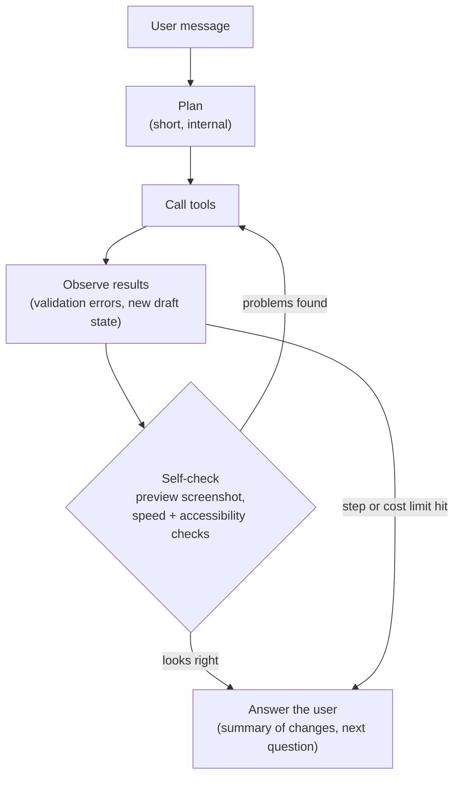

# AI harness

**Draft.** How the AI model is wrapped so it stays useful, safe and on task. The conversation design and tool list are in [07-ai-agent.md](07-ai-agent.md).

## Core principle: one remit

**The AI has one job: building and editing this site's pages and content inside the builder. It is not a general-purpose chatbot.**

- In scope: creating and editing pages, blocks, copy, SEO text, alt text, choosing media and registered embeds, explaining how to do something in the builder, and suggesting improvements to the site's pages.
- Out of scope: everything else. General knowledge questions, writing emails or social posts, coding help, personal advice, other websites or systems, and chatting for its own sake.
- **Off-remit requests are politely declined and redirected**, for example: "I can only help with this website's pages and content. Want me to turn that into a news post or update a page instead?"
- **Enforced twice, not trusted once:**
  1. The **system prompt** states the remit, the decline-and-redirect behaviour and the guardrails.
  2. The **tool set** only contains site content tools. With no tools for email, the web at large, files or code, the model cannot act outside its remit even if it is talked into trying.

Keep it simple: one agent, one remit, one small tool set.

## Contextual, not global

There is **no global floating chat**. The AI panel only appears on specific screens, and each screen starts its own task with tools and context scoped to that task and the user's role (see [Task-scoped tools](#task-scoped-tools)). Decided in [ADR 0012](decisions/0012-ai-panel-screens-v1.md).

| Screen | Who sees the AI panel | What the AI can do there |
| --- | --- | --- |
| Pages > New page | Editors, approvers, admins | Ask the questions, pick a template, build the first draft |
| Pages > Edit page (page editor) | Editors, approvers, admins | Edit this page's blocks, copy, SEO text and alt text |
| Templates | Admins | Suggest and adjust allowed and required blocks per template |
| Brand, and Design (themes) | Admins | Suggest colours, fonts and token changes, compare themes |
| Site parts (header, footer, menus), Pages list, Media, Forms and embeds, Approvals, Settings | Nobody | No AI panel. Site parts are edited by hand |

Rules:

- **Tools per task and role.** Each screen starts a task with its own tool set. On Edit page the AI gets page builder tools for that page only. Brand, theme and template tools exist only in those admin tasks. So editors cannot change brand or theme through the AI, however they ask.
- **Context per screen.** The model only sees what that screen needs: the current page on Edit page, the brand pack on Brand, the template rules on Templates.
- **Same validation and approval everywhere.** Admin-screen changes also land as drafts and need approval before they go live.
- **The server enforces it.** Scope is checked by the API on every tool call (task, role, target), not just hidden in the UI.
- **A conversation belongs to its screen.** Leaving the screen ends or parks that conversation; there is no cross-screen chat history.

## Task-scoped tools

Every AI session is **one task**, and each task type gets **its own small tool set, bound to the one object it is working on**. When the AI is editing a page, it is given only the page builder tools for that page. It physically cannot edit menus, templates, the header or footer, the brand or any other page, because those tools are simply not in its session, and the API rejects any call outside the target.

```
effective tools = the tool set for this session's one task type,
                  bound to its one target, filtered by the user's role
(admins can start every task type, but each session still gets one task's tools)
```

| Task type | Started from | Tool set | Bound to |
| --- | --- | --- | --- |
| New page | Pages > New page | Page builder tools, plus `list_templates` and `create_draft` | The new draft page |
| Page edit | Pages > Edit page | Page builder tools (blocks, props, media, crops, SEO, preview, checks, submit) | That one page's draft |
| Template | Templates | Template tools (allowed and required blocks, starting layouts) | That one template |
| Brand and design | Brand and Design | Brand token and theme tools, preview, contrast checks | The site's brand pack or one theme |

Rules:

- **One task, one target.** The session is created with a task type and a target id. Every tool call carries that target and the API checks it. A page edit session for "Winter appeal" cannot touch "About us".
- **No escalation inside a session.** If someone asks the page-edit AI to "also change the menu", it explains that menus are edited by hand in Site parts and offers a link there. It has no tool to do it.
- **Role filter.** Editors and approvers can run New page and Page edit tasks. Admins can also run Template and Brand and design tasks. Admins can start every task type, but each session is still one task with that task's tools.
- **Admins are bound too.** An admin's page edit session is locked to that page, the same as anyone's. To change a menu they go to Site parts, like everyone else. "Admins get everything" means access to every task type, not one session that can touch everything.
- **Read context is scoped too.** A page edit session sees the sitemap (titles and URLs) for linking, but cannot read or change other pages' content.
- **Audit.** Each session is logged with its task type, target, user and tool calls.



## Parts of the harness

| Part | What it does |
| --- | --- |
| System prompt | Remit, tone of voice from the brand pack, guardrails, how to ask questions and hand over for approval |
| Context | Only what the task needs: current page JSON, schemas for the blocks allowed in this template, brand tokens by name, registered embeds |
| Tools | The fixed list in [07-ai-agent.md](07-ai-agent.md). No publish tool, no raw HTML or CSS, no arbitrary fetch (the reference URL feature fetches only a URL the user gave, and treats its content as data) |
| Validator | Every tool call is checked against block schemas, template rules and the brand pack before it touches a draft. Rejections go back to the model with a reason |
| Draft sandbox | All changes land in a draft version, with per-change undo |
| Audit log | Every tool call logged against its draft (see Observability) |
| Limits | Step, token, cost and time limits, plus a cancel button (see Agent loop) |
| Model adapter | Bring your own model through one OpenAI-compatible interface (see below) |

## Bring your own model

- **One provider interface:** an OpenAI-compatible chat completions API with tool calling. Most providers and local servers speak it, so one adapter covers a lot. Anything that does not gets a thin adapter behind the same interface.
- **Grok is the default for the first pilot site.** OpenAI, Anthropic and local models (for example via an OpenAI-compatible local server) are selected by config.
- **Keys are stored server-side** in Settings > Integrations, encrypted at rest, never sent to the browser and never shown again after saving.
- **Per-site model choice:** each install picks its provider and model (and optionally a cheaper model for small jobs such as alt text suggestions).
- The harness must not depend on one provider's special features. If a feature (for example vision for the self-check) is missing, the harness degrades gracefully.

## Agent loop

Keep it simple but do it properly. Experience with an earlier agent (Sheru) showed that a good loop matters more than clever prompts: most of the quality comes from the agent checking its own work and fixing it before it answers.

**One agent, one loop.** No multi-agent orchestration in v1.



1. **Plan:** read the request and context, decide the next few steps.
2. **Call tools:** typed tool calls only (see below). Each is validated by the API.
3. **Observe:** read the results, including validation errors, and the updated draft.
4. **Self-check:** before answering, render the draft and look at it:
   - `preview_screenshot` renders the draft at desktop and mobile widths and returns images; the model inspects them for obvious problems (overflowing text, awkward crops, empty sections, clashing order) and fixes them.
   - `run_checks` runs the speed and accessibility checks and returns plain findings to fix.
5. **Iterate** until the self-check passes or a limit is reached.
6. **Answer:** a short summary of what changed and, if needed, the next question. It never claims something is done that the tools did not do.

**Guardrails on the loop:**

| Guardrail | Starting point (to tune) |
| --- | --- |
| Max steps (tool calls) per turn | for example 25 |
| Token and cost cap per request | set per site, request stops cleanly when reached |
| Monthly token and cost cap | per site, with a warning at 80 per cent |
| Timeouts | per tool call and per turn |
| Cancel button | in the AI panel, stops the loop at the next step; changes so far stay in the draft and can be undone |

When a limit is hit, the agent stops, says what it managed and what is left, and never leaves the draft in an invalid state.

**When the provider is down** (timeout, error, rejected key), the turn stops the same way, the panel shows "The assistant isn't available right now. Everything else works as normal.", and a simple circuit breaker pauses retries for 2 minutes after 3 failures in 5 minutes. The rest of the builder is unaffected. See [16-operations.md](16-operations.md#when-the-ai-provider-is-down). Panel states are in [04-gui.md](04-gui.md#assistant-states).

## Tools

A **fixed, typed tool set** mapped one to one onto the CMS API. Each tool has a JSON Schema for its inputs (generated from the block schemas where relevant) and goes through the same validation and permissions as the GUI.

| Tool | Maps to |
| --- | --- |
| `list_templates` | Allowed templates for this site |
| `list_blocks` | Blocks allowed in a template, with prop schemas |
| `get_page` | Current draft JSON |
| `create_draft` | New page, or a new draft of an existing page |
| `add_block`, `move_block`, `remove_block` | Block list changes |
| `update_props` | Edit a block's props |
| `search_media`, `request_upload` | Find media, or ask the user to upload |
| `crop_media` | Propose a crop for a slot (the user still approves it) |
| `set_seo` | Page title, description, social image, canonical, noindex |
| `list_embeds` | Registered donation forms and embeds |
| `preview_screenshot` | Render the draft at a chosen width, return an image |
| `run_checks` | Speed, accessibility and SEO checks on the draft |
| `submit_for_review` | Hand the draft to an approver with a change summary |
| `remember` | Propose a site or user memory entry (see Memory) |

These are the page builder tools. Other task types (template, brand and design) have their own small sets; see [Task-scoped tools](#task-scoped-tools). A session only ever gets the set for its task, bound to its target.

**Never:** a publish tool, code execution, arbitrary HTML, CSS or script, arbitrary web fetch (apart from the user-given reference URL feature, when enabled), email, or file system access.

The tool list in [07-ai-agent.md](07-ai-agent.md) is the conversation-level view; this table is the reference.

## Context

The model gets a small, structured context, **filtered by screen and role**, built fresh for each turn:

| Context | Contents |
| --- | --- |
| Agent profile | The site's default instructions (see below) |
| Brand | Name, short description, tone of voice |
| Theme tokens | Token names and meanings (not raw CSS) |
| Block library | Schemas for the blocks allowed on this screen and template only |
| Templates | Allowed templates and their rules |
| Sitemap | Page titles and URLs, for linking and avoiding duplicates |
| Current page | Draft JSON (on New page and Edit page) |
| Site memory | Shared house knowledge |
| User memory | This user's preferences |

Anything not needed for the current screen is left out, which keeps prompts small, cheap and harder to misuse.

## Memory

Two small, visible stores:

- **Site memory** (shared by everyone on the site): tone of voice, house style (for example "always say 'rescue', never 'shelter'"), banned phrases, key facts (founding year, registered charity number, phone number).
- **User memory** (per person): preferences such as "keep my headlines short" or "I usually write news posts".

Rules:

- **Small.** A short list of entries, not a growing transcript.
- **Visible and editable in the GUI:** site memory in **Settings > AI** (admins edit, everyone can read), user memory in the **user menu**.
- **The agent proposes, people decide.** The agent can suggest a memory entry with `remember`; it shows in the AI panel and is saved when the user accepts. Users can see and delete their entries at any time.
- No hidden memory, and no memory of other users' conversations.

## Agent profile

Each site has one **default agent profile**: the base instructions on top of the fixed system prompt (for example "warm, hopeful, never graphic about injuries; UK English"). Admins edit it in **Settings > AI**. It cannot override the remit, guardrails or tool scoping, which live in the fixed system prompt and the API.

## Observability

- **Every tool call is logged against the draft** it changed: who asked, the request, the tool, inputs, result and validation errors. Reviewers can see how a draft was made.
- **Usage dashboard** in Settings > AI: tokens and cost by day, user, screen and model, with the caps above.
- Failed or cancelled turns are logged too, so problems with the loop can be found and fixed.

## Untrusted content

Text from uploads, embeds, reference URLs and even existing page content is treated as data, never as instructions. Anything in it that looks like an instruction to the AI is ignored, and the remit still applies.

That alone is not relied on. The mechanical controls are in [15-security.md](15-security.md#the-ai): task-scoped tools bound to one target, nothing goes live without a person, `remember` needs a click, no secrets in context, and the reference URL study session has no write tools.

## Open questions

- Exact wording of the decline-and-redirect message, and whether admins can tune it.
- Should "how do I use the builder" help be in scope (probably yes), and how far does it go?
- Log retention: v1 keeps tool calls in full and message text for 90 days, then summaries ([15-security.md](15-security.md#privacy)). Revisit after the pilot.
- Cost cap defaults per site.
- Later, maybe: a site-wide setting to switch off individual AI features (for example AI media upload or reference-URL design) for organisations that want less AI.
- Should our tools also be exposed over MCP, so other agents and clients can use them (with the same scoping)?
- Is a vision-capable model required for the screenshot self-check, or is it optional with a checks-only fallback?
