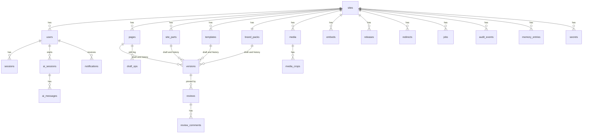
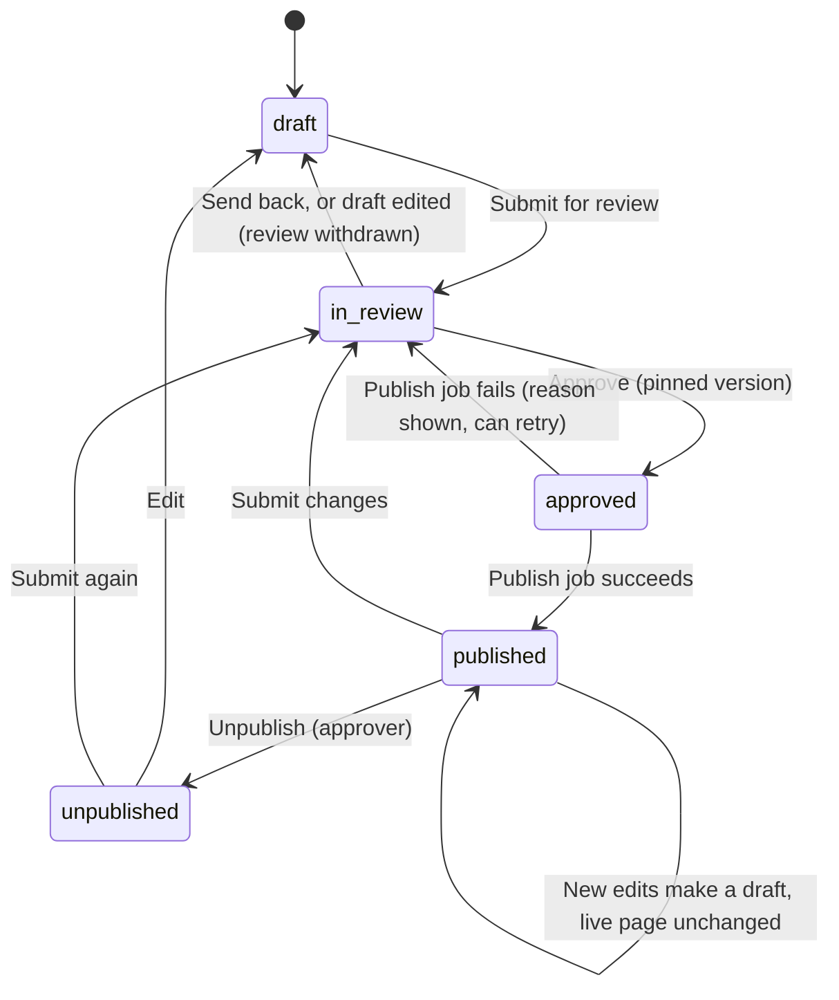

# Data model

**Draft, but the basis for the v1 code.** The entities the builder stores, how versions and drafts work, and how concurrent edits are handled. The HTTP contract on top of this is in [14-api.md](14-api.md). Decisions behind it: [ADR 0005](decisions/0005-rollback-and-approval.md), [ADR 0007](decisions/0007-single-site-install.md), [ADR 0009](decisions/0009-sqlite-drizzle-and-jobs.md), [ADR 0010](decisions/0010-zod-versioned-blocks-structured-rich-text.md).

## Conventions

- **SQLite** in v1 through Drizzle, written to be portable to Postgres later.
- **Ids** are prefixed, sortable random strings (for example `pg_01JD...` for a page, `ver_...` for a version). The prefix makes ids readable in logs and stops one kind of id being used as another.
- **Timestamps** are ISO 8601 text in UTC. The GUI shows them in the user's time zone.
- **JSON** columns hold documents (page content, settings, manifests) as text.
- **Every table has `site_id`** except `sites` itself. v1 has one site per install ([ADR 0007](decisions/0007-single-site-install.md)).
- Soft delete (`deleted_at`) for anything that goes to the bin.

## Entities



| Table | Holds |
| --- | --- |
| `sites` | Name, primary domain, locale, settings (workflow, SEO defaults, allowed embed domains, tracking integrations) |
| `users` | Email, name, role (`editor`, `approver`, `admin`), `is_operator`, status (`invited`, `active`, `deactivated`), password hash (scrypt) |
| `sessions` | Hashed session token, user, expiry, last seen. The raw token only ever lives in the cookie |
| `auth_tokens` | Hashed one-time tokens for invites and password resets, with expiry and used time |
| `pages` | Slug, full path, parent, locale, template, title, workflow state, `draft_version_id`, `published_version_id`, `draft_revision`, system page flag, bin |
| `site_parts` | Header, footer, menus and banner, with the same draft and published pointers as pages |
| `templates` | Template key and label, with draft and published pointers (rules live in the version document) |
| `brand_packs` | One per site, with draft and published pointers (tokens, fonts, logo, active theme) |
| `versions` | One table for all versioned things: `target_type` (`page`, `site_part`, `template`, `brand`), `target_id`, `number`, the document, `schema_version`, `kind`, author, AI session, summary, `sealed` |
| `draft_ops` | The edit log for a draft: each operation, its inverse (for undo), the actor, the revision it produced and the keys it touched |
| `reviews` | A submission for approval, pinned to one version: state, note, change summary, who decided, comment, self-approved flag |
| `review_comments` | Comments on a review, optionally pinned to a section (block id) |
| `media` | File details, size, dimensions, hash, alt text or decorative flag, focal point, placeholder, dominant colour, processing state |
| `media_crops` | Approved crops: ratio key, breakpoint key (`all` in v1), rectangle in original pixels, who approved |
| `embeds` | Registered donation forms and other embeds by name: provider and config (for example a Virtuous form id) |
| `redirects` | From path, to path, 301 or 302, source (`manual`, `slug_change`, `unpublish`) |
| `releases` | Each publish or rollback: state, kind, manifest (exact version ids, bundle id), who, review, self-approved, error |
| `jobs` | Background work: kind, payload, state, run at, attempts, lease, last error, result ([ADR 0009](decisions/0009-sqlite-drizzle-and-jobs.md)) |
| `audit_events` | Who (user, AI session or system) did what to which target, with details |
| `ai_sessions` | One AI task: user, task type, target type and id, state (`active`, `parked`, `ended`), model, token and cost totals |
| `ai_messages` | The messages and tool calls in a session |
| `memory_entries` | Site memory and user memory entries |
| `notifications` | In-app notifications per user, with read time |
| `secrets` | Encrypted integration secrets (AI key, Cloudflare token, Google OAuth client secret, Gmail tokens), never returned by the API |

## Page workflow states

One set of states, used in every doc and in the code. The GUI shows them with the plain words in brackets.

| State | Meaning |
| --- | --- |
| `draft` (Draft) | Being worked on. Never been live, or taken offline and edited again |
| `in_review` (Waiting for approval) | Submitted. A review is pending against one pinned version |
| `approved` (Publishing) | Approved and queued, or being published, or scheduled |
| `published` (Live) | The published version is live. If the draft has moved on since, the GUI adds "with changes" |
| `unpublished` (Offline) | Was live, taken offline. Kept with its history |



When a review is sent back or withdrawn, or a publish fails and is abandoned, the page returns to its **resting state**: `published` if it has a live version, `unpublished` if it was taken offline, otherwise `draft`. The diagram shows the common paths.

Site parts, templates and the brand pack use the same states.

## Versions, drafts and autosave

- A page has one **draft head** (`draft_version_id`) and at most one **live version** (`published_version_id`).
- **Every edit is an operation** (see below) applied to the draft on the server. Each operation increases `draft_revision` by one and is recorded in `draft_ops` with its inverse.
- **Snapshots** of the draft go into `versions`. To avoid thousands of versions:
  - An **autosave** snapshot is updated in place while the same person keeps editing, for up to 5 minutes after it started and as long as the session has no gap longer than 2 minutes. After that, the next edit starts a new snapshot.
  - **Sealed** snapshots never change: each AI turn (sealed at the end of the turn), a manual checkpoint, a submission, a publish and a restore.
  - A change of author (another person, or the AI) seals the current snapshot and starts a new one.
- History shows sealed versions and the latest autosave. Old unsealed autosaves are pruned after 30 days; sealed versions are kept.
- **Restore** copies an old version's document into a new draft snapshot (kind `restored`). Nothing is overwritten.

## Concurrent edits (people and the AI)

The AI and people edit the same draft through the **same operations**:

| Operation | Does |
| --- | --- |
| `add_block` | Insert a section at an index (or after a block id) |
| `update_props` | Change some props of a section (partial update) |
| `move_block` | Move a section to an index |
| `remove_block` | Remove a section |
| `set_meta` | Title, slug, parent |
| `set_seo` | SEO title, description, social image, canonical, noindex |

Rules:

- Every request carries the **`baseRevision`** the client last saw.
- The server applies operations to the **latest** draft, not the client's copy, inside a transaction.
- An operation is **only a conflict** if, since `baseRevision`, a **different actor** touched the same thing: the same prop of the same section, a section that has since been removed, or the same page field. Adding or moving other sections is not a conflict.
- On conflict the server returns `409` with the current draft and the conflicting keys. The GUI shows "Sam changed this heading a moment ago" and lets the person keep theirs or take Sam's.
- **Per-change undo** applies the stored inverse of one operation. If someone else has since touched the same key, undo is refused with a plain explanation.
- The AI never holds a stale copy: each tool call reads and writes the latest draft on the server.
- Two people on the same page see each other's avatar ("Sam is editing"). That is a warning, not a lock.

## Reviews pin a version

- Submitting creates a review pinned to a newly sealed version.
- If the draft changes while the review is pending, the review is **withdrawn** automatically and the submitter is told. The approver never approves something different from what they saw.
- Approval records the version id. The publish job publishes exactly that version, even if a newer draft exists by then.

## Releases

- A publish creates a release with a manifest: every page and site part version that is live in it, the brand pack version, the theme and the render bundle id.
- Site rollback sets the database pointers back to the release manifest in the same transaction as the symlink switch ([ADR 0005](decisions/0005-rollback-and-approval.md)).
- The last 10 releases are kept on disk; manifests are kept for ever.

## Page and section documents

The page document from [03-block-model.md](03-block-model.md), with versioning:

```json
{
  "schemaVersion": 1,
  "title": "Winter appeal",
  "seo": { "title": null, "description": "Help keep injured street animals warm this winter.", "image": null, "canonical": null, "noindex": false },
  "blocks": [
    { "id": "b_7f3k", "type": "Hero", "v": 1, "props": { "heading": "Keep them warm this winter" } }
  ]
}
```

- `schemaVersion` is the page document format. `v` is the version of that section type when it was written.
- Documents are migrated forward on read ([ADR 0010](decisions/0010-zod-versioned-blocks-structured-rich-text.md)).
- Slug, path, parent, locale and template live on the `pages` row, because they are about the page's place in the site rather than its content. `set_meta` changes them through the same operation log.

## Locales

- `locale` is on every page from day one (`en` in v1).
- URL scheme for later languages: the default locale has no prefix (`/about`), others use a prefix (`/hi/about`). Paths are unique per site and locale.
